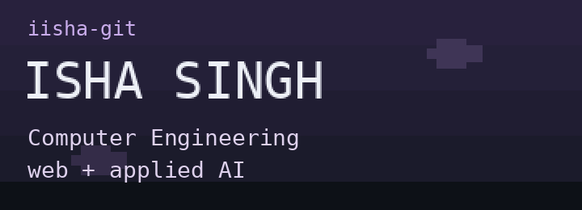
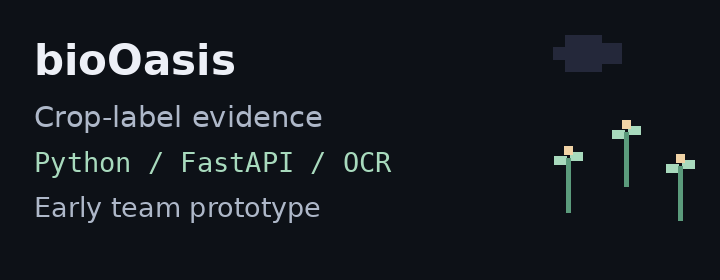
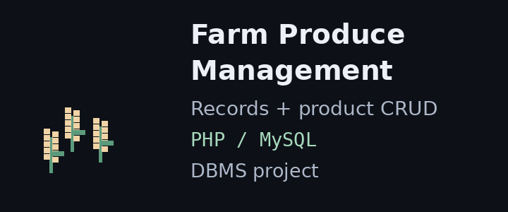
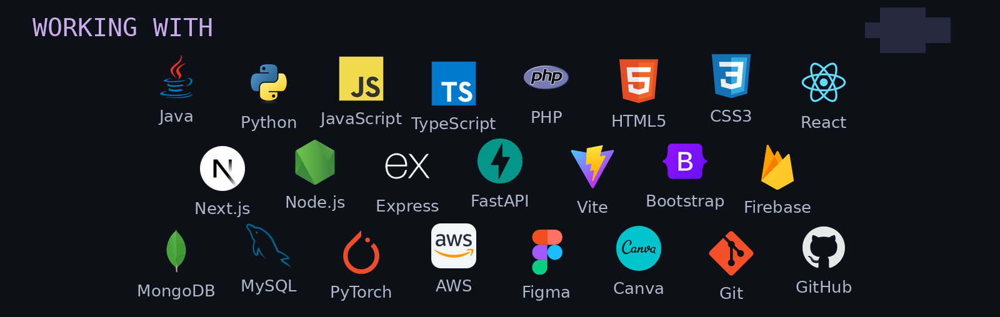
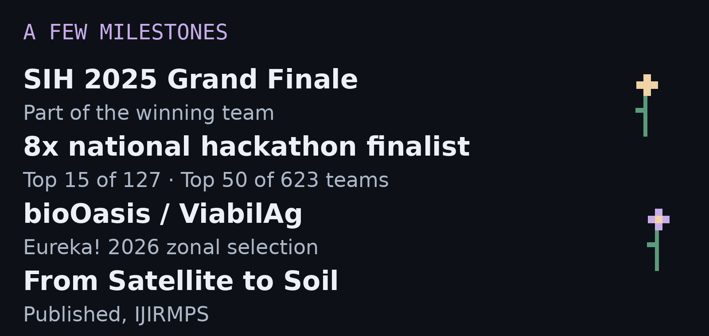
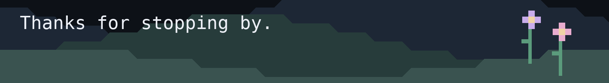

 
 
 
 
 
 
 
 
 
 

[LeetCode](https://leetcode.com/u/isha_lc/) / [Codeforces](https://codeforces.com/profile/iisha__) / [GeeksforGeeks](https://www.geeksforgeeks.org/profile/studyepol)

CMO & Design Lead at Revenex Ventures.

[**More of my work ↗**](https://isha-singh.vercel.app/)

Read as text

Isha Singh, Computer Engineering student working on web apps, applied-AI prototypes and design.

- bioOasis: early team prototype for crop-product label evidence. Python, FastAPI, OCR.
- NyayVivek: legal case-research team prototype for similar-case retrieval. React, FastAPI.
- E-Cell AVCOE: campus website. React, Vite, Cloudflare Pages.
- Farm Produce Management: records and product CRUD. PHP, MySQL.
- KrishiSense: team-built yield and insurance prototype. Next.js, TypeScript, Firebase.
- Tools across projects and practice: Java, Python, JavaScript, TypeScript, PHP, SQL, HTML/CSS, React, Next.js, Node.js, Express, FastAPI, Firebase, MongoDB, MySQL, Figma, Canva (5+ years), Git and GitHub.
- Part of the Smart India Hackathon 2025 Grand Finale winning team. 8x national hackathon finalist (Top 15 of 127, Top 50 of 623 teams). bioOasis/ViabilAg selected for the Eureka! 2026 zonal round. Co-author of "From Satellite to Soil", published in IJIRMPS (DOI 10.37082/IJIRMPS.v13.i6.232843).
- Daily DSA: Java, approaches and complexity.

